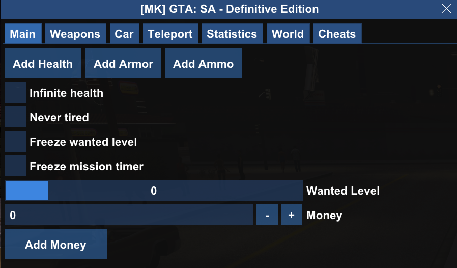
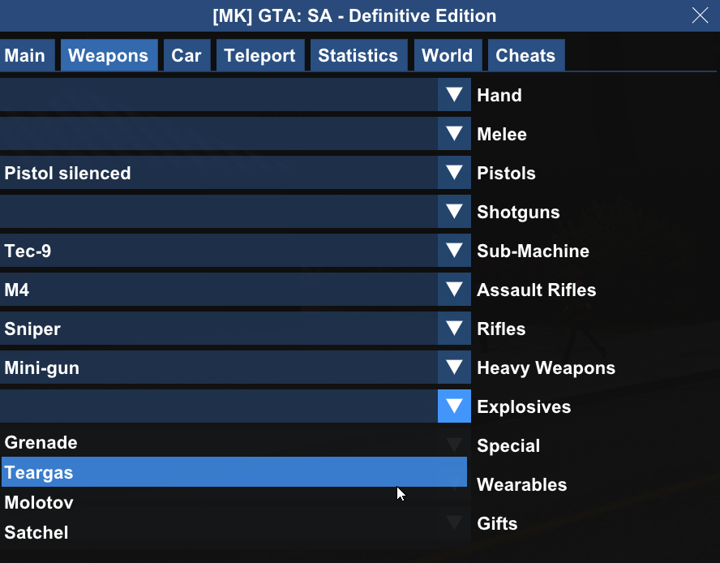
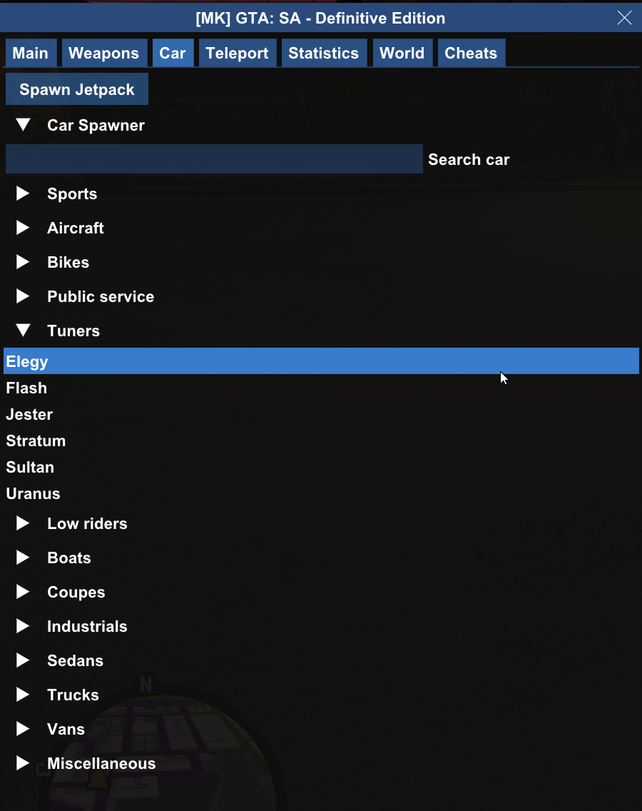
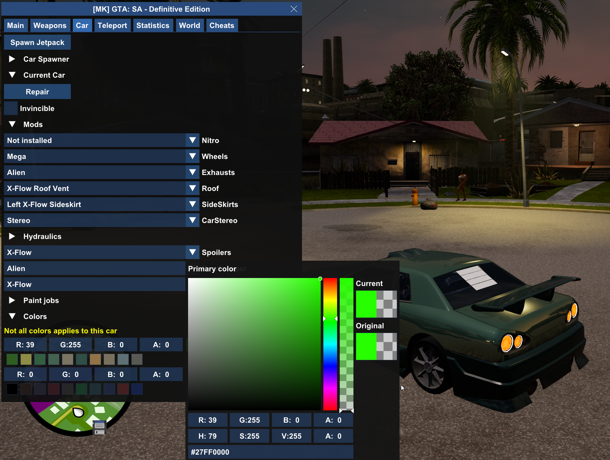
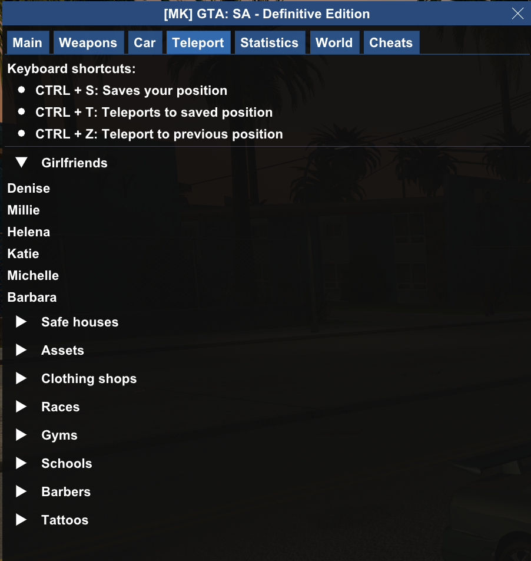
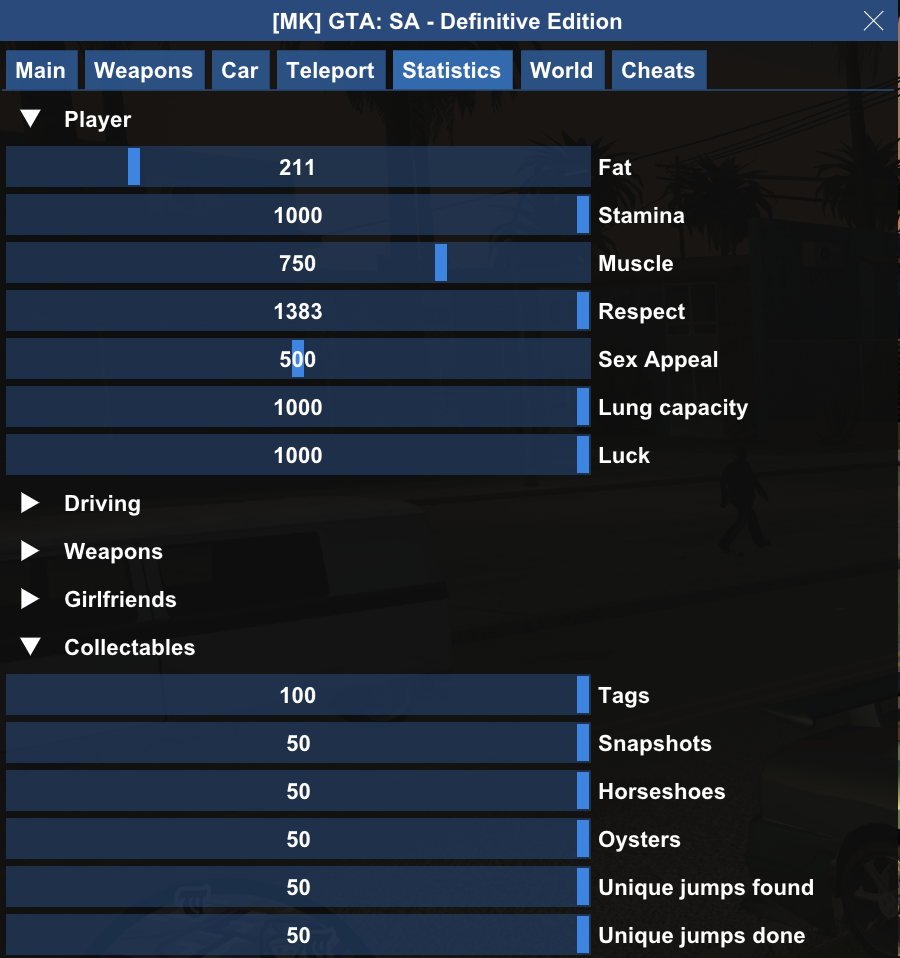
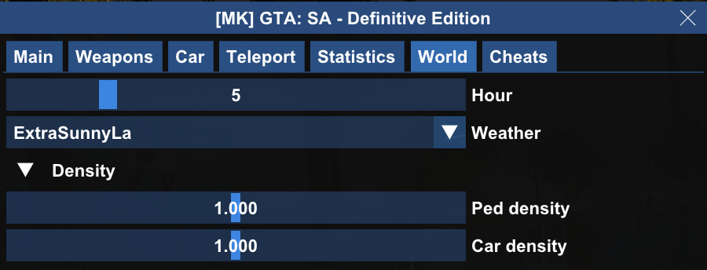
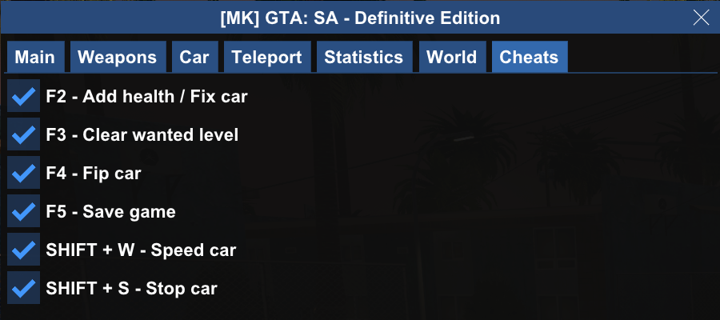

# GTA: Definitive Edition - Cheat Menu mod

## Installation

1. Install [CLEO Redux](https://re.cleo.li/) 1.5.0 or newer for the target game.
2. Copy mod directory to CLEO library `...\GTA III/VC/San Andreas - The Definitive Edition\Gameface\Binaries\Win64\CLEO\cheat-menu`
3. Set the game config to Windowed Fullscreen/Borderless Window

## Usage

Press `F1` key in game to open/close the menu.

### Keyboard shortcuts

| Keys | Action |
| --- | --- |
| `F1` | Open / close the menu |
| `Ctrl + Space + R` | Restart the menu (the running instance closes itself) |
| `F2` / `F3` / `F4` / `F5` | Add health & fix car / clear wanted level / flip car / save game (enable in *Cheats*) |
| `Shift + W` / `Shift + S` | Speed up (repeats while held) / stop the car (Vice City, San Andreas) |
| `Ctrl + S` / `Ctrl + T` / `Ctrl + Z` | Save position / teleport to it / go back to the position before the last teleport |
| `Ctrl + R` | Save the current position with a name |
| `F6` | Teleport to the map waypoint* |
| `F7` | Teleport to the mission destination / target* |

`F1`-`F7` and the `Ctrl` shortcuts fire once per key press.

## Features

### Main

### Weapons

### Car

*  Spawner

* Tuning

### Teleports

Vice City also has:
* **Hidden packages** (100) and **Rampages** (35) - only the ones not collected yet are listed, plus *Teleport to nearest*; the hidden package counter comes from the game.
* **Unique stunt jumps** (36) - puts you 35 m before the ramp, facing it, with a running start (a car is needed).
* **Store robberies** (15) - in front of the shopkeeper; aim at them to start the robbery.
* **Teleport to waypoint** (`F6`) and **Mission targets** (`F7`, or pick one from the list: destinations, vehicles, people) *.

Collectible coordinates were extracted from the game's `main.scm`.

### Statistic editor

### World editor

### Cheats

Vice City *Side missions* section *: complete Paramedic, Firefighter, Vigilante and Taxi Driver instantly (same rewards, 100% progress and completion flags as finishing the last level), and set the Cherry Popper ice cream sales to 50 during the ice cream mission.

\* These features read/write game memory at offsets found in the **1.0.113.21181 (Steam)** builds of GTA III, Vice City and San Andreas DE (side missions: Vice City only). On any other build they are switched off automatically (`cleo_redux.log` says which).

## Credits

Thanks to:
* [Map Genie](https://mapgenie.io/grand-theft-auto-san-andreas/maps/san-andreas) for providing all teleport locations.
* [GTA Fandom](https://gta.fandom.com) for car colors.
* [Wiki MultiTheftAuto](https://wiki.multitheftauto.com) for all object IDs.

### Known Bugs

* After alt-tab, the menu is no longer visible
* Car hydraulics mod cannot be removed, but this may be inherent to how the game works.
* Car colors may not apply correctly; unfortunately, I couldn't find a reliable source defining supported car color IDs.

## Contributing

Type-check against the definitions CLEO Redux generates for a game: copy that game's `CLEO\.config` folder next to `tsconfig.json`, then run `npm install` and `npm run typecheck:iii`, `typecheck:vc` or `typecheck:sa`.

Feel free to contribute by reporting issues or creating pull requests.

## License

This mod is licensed under the [ISC License](LICENSE).

